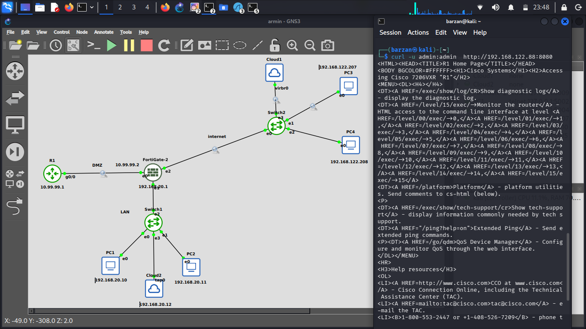
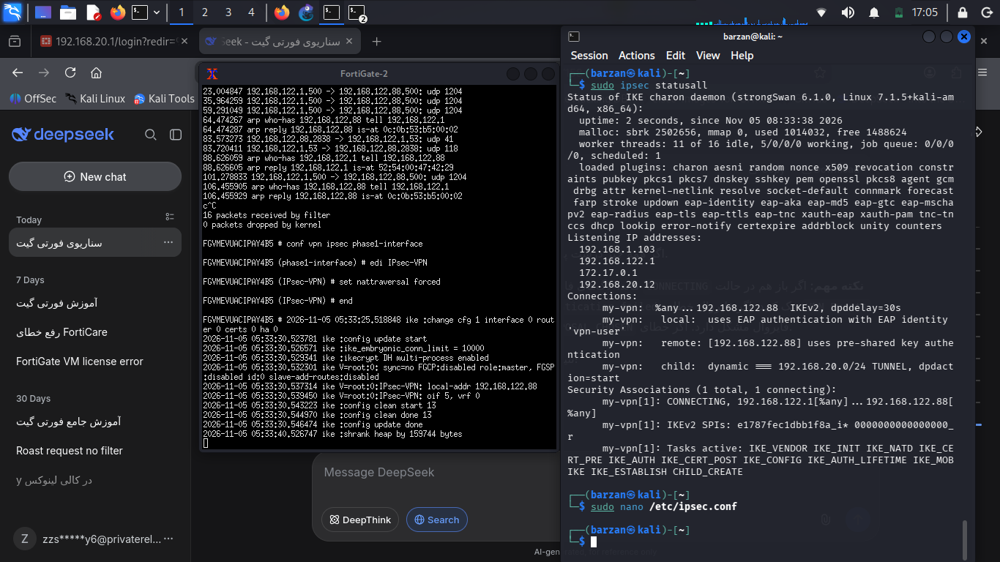

# FortiGate Enterprise Network Security Lab

## 📌 Project Overview
This project demonstrates the implementation of a secure, segmented enterprise network using a FortiGate Firewall (v7.6) simulated in GNS3. The objective was to enforce strict security boundaries, implement robust NAT policies, and secure traffic between three distinct zones: WAN (Internet), LAN (Internal Users), and DMZ (Servers).

## 🗺️ Network Topology

## 📊 IP Addressing Schema
| Zone | Interface | IP Address / Subnet | Method |
| :--- | :--- | :--- | :--- |
| **WAN** | port3 | DHCP (Received) | Dynamic |
| **LAN** | port2 | `192.168.20.1/24` | Static (Gateway) |
| **DMZ** | port1 | `10.99.99.2/24` | Static |
| **DMZ Server** | R1 | `10.99.99.1/24` | Static |

## 🛡️ Key Implementations & Security Features
*   **Security Zoning:** Segregated the network into LAN, WAN, and DMZ to minimize the attack surface.
*   **Management Plane Security:** Restricted administrative access (`HTTPS`, `SSH`) strictly to the LAN interface, preventing external brute-force attacks.
*   **DHCP & Routing:** Configured DHCP server for LAN clients and default routing via WAN DHCP client.
*   **Advanced NAT (Central SNAT):** Implemented Central SNAT to separate access control (Firewall Policies) from address translation. This ensures LAN-to-DMZ traffic remains un-NATed (preserving original source IPs for logging), while LAN-to-WAN traffic is NATed via the outgoing interface.
*   **Virtual IP (VIP):** Configured Port Forwarding to securely expose a web service hosted in the DMZ to the internet (WAN:8080 -> DMZ:80).
*   **Least Privilege Principle:** Strict firewall policies allowing only necessary services (e.g., HTTP/HTTPS/DNS from DMZ to WAN, blocking DMZ-to-LAN completely).

## 🧪 Validation & Testing
*   **LAN to WAN:** PC1 successfully pings `8.8.8.8` (NAT Verified via Wireshark).
*   **LAN to DMZ:** PC1 successfully pings and connects to Server R1 without NAT translation.
*   **WAN to DMZ (VIP):** External client PC3 can access the DMZ web server via the firewall's WAN IP on port 8080.
*   **DMZ to LAN:** Explicitly blocked (Implicit Deny) to prevent lateral movement in case of a DMZ compromise.

### 3. Blocked Traffic (DMZ to LAN) - Security Enforcement
To prove that network segregation is working effectively, a ping test was initiated from the DMZ server (R1) to the LAN client (PC1). The connection is successfully blocked (100% packet loss) by the firewall's Implicit Deny rule, preventing lateral movement in case of a DMZ compromise.

### 4. VIP (Port Forwarding) Test - WAN to DMZ
This screenshot demonstrates a successful HTTP request from an external client (Kali Linux in WAN) to the DMZ web server (Cisco R1). The request hits the FortiGate on port 8080, is translated via Virtual IP, and successfully retrieves the Cisco HTML page (`R1 Home Page`). This proves that Port Forwarding and WAN-to-DMZ policies are functioning correctly.

### ⚠️ Note on IPsec VPN (Evaluation License Limitation)
I configured an IPsec Dial-Up VPN (IKEv2) with EAP authentication to allow remote access. The client (StrongSwan on Kali Linux) and FortiGate were configured with matching Phase 1/Phase 2 proposals (3DES-SHA256). 

**Troubleshooting Process:**
Using `diagnose sniffer packet any 'udp port 500'` on the FortiGate, I confirmed that IKE packets from the client were successfully reaching the WAN interface. However, `diagnose debug application ike -1` showed no incoming IKE negotiations. 

**Conclusion:**
It was identified that the **FortiGate-VM Evaluation License** in GNS3 silently drops IPsec VPN traffic at the kernel level before it reaches the IKE daemon. This is a known limitation of the free evaluation version. The configuration was verified as correct and documented as a troubleshooting exercise.

**Troubleshooting Evidence:**

*Kali Linux Client stuck in CONNECTING state:*

*FortiGate Sniffer showing UDP 500 packets being received but dropped:*

---

### 6. Next-Generation Firewall (NGFW) - UTM Profiles
To secure the network beyond basic IP/Port filtering, three UTM (Unified Threat Management) profiles were configured and applied to the LAN-to-WAN policy:
*   **Web Filter (`Block SocialMedia`):** Configured with a Static URL Filter to block specific domains (e.g., instagram.com).
*   **IPS (`Block Attacks`):** Configured to block Critical, High, and Medium severity signatures, as well as Botnet C&C connections.
*   **AntiVirus (`Scan Downloads`):** Configured to scan HTTP and FTP traffic in Flow-based mode for malware.

*UTM Security Profiles applied to the firewall policy:*

---

### 7. Configuration Backup
The complete FortiGate configuration, including all interfaces, routing, policies, and UTM profiles, has been securely backed up using **SCP (Secure Copy Protocol)**. 
The backup file is available in the project directory: [`configs/fortigate-full-config.txt`](configs/fortigate-full-config.txt)
