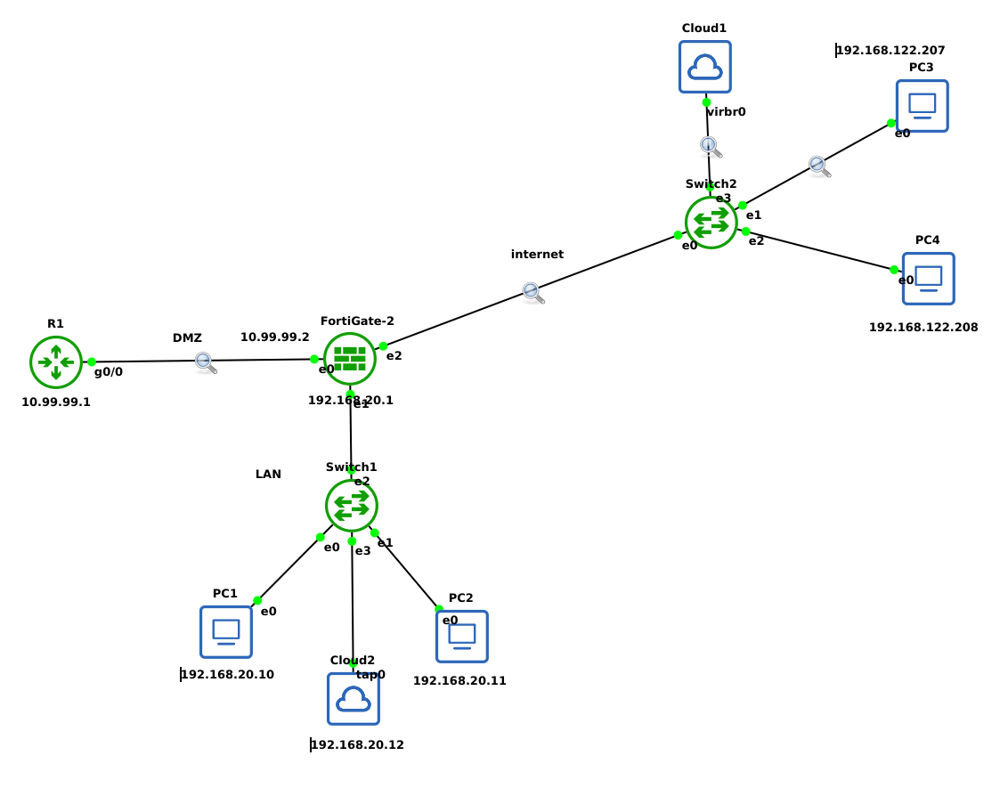
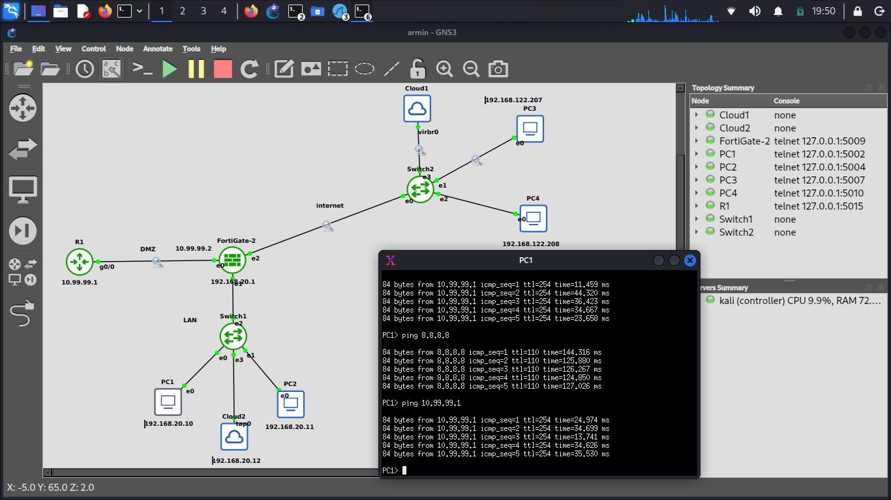

# FortiGate Enterprise Network Security Lab

## 📌 Project Overview
This project demonstrates the implementation of a secure, segmented enterprise network using a FortiGate Firewall (v7.6) simulated in GNS3. The objective was to enforce strict security boundaries, implement robust NAT policies, and secure traffic between three distinct zones: WAN (Internet), LAN (Internal Users), and DMZ (Servers).

## 🗺️ Network Topology

## 📊 IP Addressing Schema
| Zone | Interface | IP Address / Subnet | Method |
| :--- | :--- | :--- | :--- |
| **WAN** | port3 | DHCP (Received) | Dynamic |
| **LAN** | port2 | `192.168.20.1/24` | Static (Gateway) |
| **DMZ** | port1 | `10.99.99.2/24` | Static |
| **DMZ Server** | R1 | `10.99.99.1/24` | Static |

## 🛡️ Key Implementations & Security Features
*   **Security Zoning:** Segregated the network into LAN, WAN, and DMZ to minimize the attack surface.
*   **Management Plane Security:** Restricted administrative access (`HTTPS`, `SSH`) strictly to the LAN interface, preventing external brute-force attacks.
*   **DHCP & Routing:** Configured DHCP server for LAN clients and default routing via WAN DHCP client.
*   **Advanced NAT (Central SNAT):** Implemented Central SNAT to separate access control (Firewall Policies) from address translation. This ensures LAN-to-DMZ traffic remains un-NATed (preserving original source IPs for logging), while LAN-to-WAN traffic is NATed via the outgoing interface.
*   **Virtual IP (VIP):** Configured Port Forwarding to securely expose a web service hosted in the DMZ to the internet (WAN:8080 -> DMZ:80).
*   **Least Privilege Principle:** Strict firewall policies allowing only necessary services (e.g., HTTP/HTTPS/DNS from DMZ to WAN, blocking DMZ-to-LAN completely).

## 🧪 Validation & Testing
*   **LAN to WAN:** PC1 successfully pings `8.8.8.8` (NAT Verified via Wireshark).
*   **LAN to DMZ:** PC1 successfully pings and connects to Server R1 without NAT translation.
*   **WAN to DMZ (VIP):** External client PC3 can access the DMZ web server via the firewall's WAN IP on port 8080.
*   **DMZ to LAN:** Explicitly blocked (Implicit Deny) to prevent lateral movement in case of a DMZ compromise.

### 3. Blocked Traffic (DMZ to LAN) - Security Enforcement
To prove that network segregation is working effectively, a ping test was initiated from the DMZ server (R1) to the LAN client (PC1). The connection is successfully blocked (100% packet loss) by the firewall's Implicit Deny rule, preventing lateral movement in case of a DMZ compromise.

